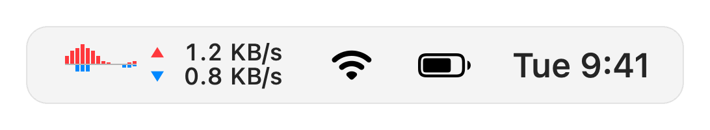

# net-thru

<p align="center">
  <picture>
    <source media="(prefers-color-scheme: dark)" srcset="docs/demo-dark.gif">
    
  </picture>
</p>

A tiny macOS menu bar app that shows how fast you're uploading and downloading, plus a small
graph of the last 14 seconds. Upload is red, above the midline; download is blue, below it.
Units adapt (KB/s, MB/s, GB/s).

Clicking it shows how much you've transferred since launch, which interfaces are being
measured, a **Launch at Login** toggle and **Quit**.

## Build & install

Needs macOS 14+ and the Xcode Command Line Tools (`xcode-select --install`). Xcode itself
isn't required.

```sh
make install     # builds build/net-thru.app, copies it to /Applications and starts it
make run         # builds and runs from build/ without installing
make uninstall   # quits it and removes it from /Applications
```

To start it automatically, click the menu bar item and enable **Launch at Login**. Turn that
off again before running `make uninstall`.

net-thru places itself next to the system icons (Wi-Fi, battery, ...), so it stays visible
when the menu bar gets crowded. ⌘-drag it to move it; macOS remembers where you put it.

## What gets counted

All `en*` interfaces: Wi-Fi, Ethernet, USB/Thunderbolt adapters and iPhone tethering. Loopback,
VPN tunnels (`utun*`), bridges, AirDrop (`awdl*`) and other virtual interfaces are left out.
VPN traffic still shows up, because it also crosses the physical interface, and leaving the
tunnels out keeps it from being counted twice. To change this, edit
`TrafficMonitor.isCounted`.

Rates are sampled once a second and use decimal units (1 KB = 1000 bytes), like Activity
Monitor.

macOS only gives ordinary apps coarse interface counters, rounded to 1 KB and wrapping at
4 GB. net-thru handles the wraparound. The rounding means the smallest visible step is about
1 KB/s.

## Layout

| File | Purpose |
| --- | --- |
| `Sources/NetThru/InterfaceCounters.swift` | Reads the kernel's per-interface byte counters (`sysctl NET_RT_IFLIST2`) |
| `Sources/NetThru/TrafficMonitor.swift` | Turns counters into rates, history and totals |
| `Sources/NetThru/StatusView.swift` | Draws the graph and the numbers in the menu bar |
| `Sources/NetThru/AppDelegate.swift` | Status item, menu, 1-second timer, launch at login |
| `Sources/NetThru/ByteFormat.swift` | "12 KB/s" / "1.2 MB/s" formatting |
| `scripts/make-icon.swift` | Regenerates `Resources/AppIcon.icns` (`make icon`) |
| `scripts/demo/main.swift` | Renders the animation above from the app's own drawing code (`make demo`) |
